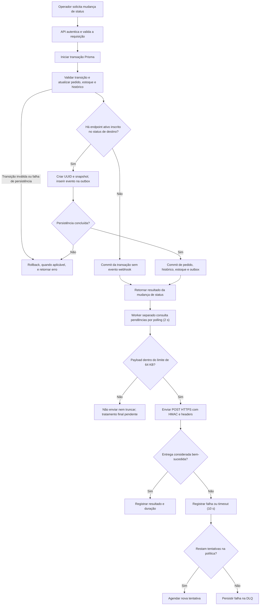

### FDD: Webhooks de saída para mudanças de status de pedidos

| Campo                   | Valor                                                                                                        |
| ----------------------- | ------------------------------------------------------------------------------------------------------------ |
| ID                      | FDD-webhooks-pedidos                                                                                         |
| Status                  | Draft                                                                                                        |
| Autor                   | Rafael Lopes                                                                                                 |
| Data                    | 2026-11-22                                                                                                   |
| Revisores               | A definir; revisão de segurança por Sofia foi informada como necessária antes do deploy                   |
| Documentos relacionados | [docs/PRD.md](PRD.md), [docs/RFC.md](RFC.md), [TRANSCRICAO.md](../TRANSCRICAO.md), [docs/TRACKER.md](TRACKER.md) |

---

### 1. Contexto e motivação técnica

O OMS atualmente permite consultar pedidos pela API, mas não possui entrega de notificações por webhook. O método `OrderService.changeStatus()` já atualiza o pedido, o histórico de status e o estoque dentro de uma transação Prisma; não há gravação de eventos de webhook nesse fluxo.

A feature adiciona notificações outbound para endpoints HTTPS dos clientes B2B. A integração deve persistir cada evento elegível na mesma transação da mudança de status, sem executar HTTP dentro do fluxo síncrono do pedido. Um worker Node.js separado consultará a outbox MySQL e enviará os eventos. A arquitetura reutiliza Express, TypeScript, Prisma, MySQL, JWT, Zod, AppError e Pino.

**Atores e limites**

- Operador ou usuário autenticado que gerencia configurações de webhook de um cliente.
- Worker que entrega notificações aos endpoints cadastrados.
- Sistema do cliente, responsável por validar HMAC e deduplicar usando `X-Event-Id`.
- Administrador com role `ADMIN`, responsável por solicitar replay de evento na DLQ.
- O escopo é exclusivamente outbound; não inclui receber webhooks de clientes.

**Premissas e restrições**

- O worker executa em processo separado, usa o mesmo banco e mantém seu próprio `PrismaClient`.
- O polling de 2 segundos e a meta de iniciar a primeira tentativa em menos de 10 segundos em operação normal não constituem SLA.
- O código atual não contém módulo de webhook, worker, outbox, histórico de entregas ou DLQ; o `package.json` também não declara comando `worker`.
- A implementação deve reutilizar `AppError`, Pino, middleware centralizado de erros, schemas Zod e o prefixo `WEBHOOK_` para códigos do módulo.
- Nesta fase, qualquer role autenticada pode executar o CRUD de configurações de webhook (`[09:36] Marcos`, `[09:37] Sofia`). O `customer_id` continua sendo informado no body ou no path e não é inferido do JWT. A autorização por vínculo persistido entre usuário e cliente é uma proposta de endurecimento futuro do RFC/ADR-021, não um requisito confirmado para esta versão.
- Soft delete, classificação antecipada de payload grande e semântica de identidade no replay continuam como propostas do RFC, pendentes de aprovação.

---

### 2. Objetivos técnicos

- Registrar de forma atômica cada evento elegível com a mudança de status, histórico e efeitos de estoque; se a persistência necessária falhar, reverter a transação.
- Selecionar somente endpoints ativos inscritos no status de destino; se não houver endpoint elegível, não criar evento.
- Entregar de forma assíncrona por HTTPS, usando polling a cada 2 segundos e timeout de 10 segundos por chamada.
- Assinar o corpo enviado com HMAC-SHA256 e uma secret exclusiva por endpoint; manter a secret anterior válida por 24 horas após rotação.
- Suportar entrega at-least-once e identidade estável do evento para que o consumidor possa deduplicar; não prometer exactly-once nem ordenação global.
- Preservar dados suficientes para consultar tentativas, diagnosticar falhas e solicitar replay administrativo.

---

### 3. Escopo e exclusões

**Incluído**

- Cadastro, edição, remoção e listagem de configurações por cliente, com URL HTTPS e status de interesse. A semântica física ou lógica da remoção ainda requer confirmação.
- Geração de secret exclusiva pelo sistema e devolução da secret na criação.
- Criação do snapshot do evento no instante da mudança e persistência transacional na outbox.
- Worker separado para polling, envio HTTP, registro do resultado e retentativas.
- Assinatura HMAC-SHA256, headers de identificação e limite de payload informado como 64 KB.
- Histórico consultável das até 100 entregas mais recentes por webhook.
- DLQ separada e endpoint de replay restrito a `ADMIN`, com auditoria do solicitante.
- Reuso dos padrões atuais de validação, erros, logging, autenticação e autorização por role.

**Excluído**

- Webhooks inbound, dashboard visual para clientes, notificações por e-mail e rate limiting de saída nesta fase.
- Múltiplos workers paralelos, garantia de ordenação global, exactly-once e arquivamento de entregas após 30 dias.

**A definir**

- Se e quando o endurecimento de autorização for priorizado: decidir se haverá vínculo usuário-cliente, sua fonte autoritativa, modelo físico, ciclo de vida, provisionamento, auditoria e contratos administrativos. Esta proposta futura não bloqueia o CRUD autenticado desta fase.

---

### 4. Fluxos detalhados e diagramas

**Fluxo principal**

- O usuário autenticado solicita a mudança de status pela API existente.
- O serviço valida a transição e, dentro da transação Prisma existente, atualiza pedido, estoque e histórico.
- Na mesma transação, o sistema seleciona as configurações ativas do cliente inscritas no status de destino.
- Para cada configuração elegível, cria um evento UUID e grava o snapshot do payload no momento da mudança.
- Após o commit, o worker independente consulta os eventos pendentes por polling, em batches pequenos e por ordem de criação.
- O worker envia POST HTTPS com o payload e headers de assinatura/identificação, aguarda no máximo 10 segundos e registra o resultado.
- O sistema agenda novas tentativas conforme a política definida e, após o limite, preserva a falha na DLQ.
- Para o CRUD de configurações, a API exige JWT válido e aceita qualquer role autenticada nesta fase. O endurecimento por vínculo usuário-cliente fica para evolução futura.

**Fluxos alternativos e exceções**

- Sem endpoints inscritos no status de destino, nenhuma linha de evento é criada.
- Falha na escrita transacional da outbox deve reverter a mudança de pedido, histórico e efeitos de estoque.
- Falha HTTP ou timeout é tratada como falha de entrega e segue a política de retentativas.
- Payload acima do teto de 64 KB é recusado sem truncamento; o destino do evento requer decisão final. O RFC propõe classificação imediata na DLQ, mas isso não é uma decisão confirmada na reunião.
- Replay administrativo deve validar a existência do item, identificar o administrador solicitante e recolocar o evento para processamento. A preservação do `event_id` e a nova identidade por tentativa são propostas no RFC/ADR-025, ainda pendentes de validação formal.
- Exclusão e claim concorrentes ainda exigem aprovação da semântica proposta no RFC: `DISPATCHING` seria uma reserva não cancelável e uma entrega já reservada poderia iniciar após a exclusão.

**Diagrama de fluxo**



O critério HTTP de sucesso e o tratamento final de payload excedente ainda precisam ser definidos. A coordenação de concorrência na exclusão, a semântica de `DISPATCHING` e a recuperação por lease também permanecem pendentes; por isso, o diagrama não os representa como decisões fechadas. O fluxo de CRUD exige autenticação por JWT; não há vínculo persistido usuário-cliente como requisito desta fase.

---

### 5. Contratos públicos (assinaturas, endpoints, headers, exemplos)

Os contratos abaixo são normativos para a implementação. Todas as rotas exigem `Authorization: Bearer <JWT>` e retornam `Content-Type: application/json`, exceto respostas `204`. Erros seguem o envelope existente `{ "error": { "code": "WEBHOOK_*", "message": "...", "details": {} } }`.

#### Criar configuração

- **Rota:** `POST /api/v1/webhooks`
- **Request:**

```json
{
  "customer_id": "7d353290-cf4d-4cc7-85f7-e6297c9f80c5",
  "url": "https://cliente.example.com/webhooks/orders",
  "statuses": ["SHIPPED", "DELIVERED"]
}
```

- **Response `201 Created`:**

```json
{
  "id": "ab3a0496-98ea-42f0-88d9-f93f06d17df2",
  "customer_id": "7d353290-cf4d-4cc7-85f7-e6297c9f80c5",
  "url": "https://cliente.example.com/webhooks/orders",
  "statuses": ["SHIPPED", "DELIVERED"],
  "active": true,
  "secret": "whsec_gerada_pela_plataforma"
}
```

- **Status codes:** `201`; `400 WEBHOOK_INVALID_REQUEST`; `401 WEBHOOK_UNAUTHENTICATED`; `409 WEBHOOK_ENDPOINT_ALREADY_EXISTS`; `500 WEBHOOK_INTERNAL_ERROR`. A secret é exibida somente na criação.

#### Atualizar configuração

- **Rota:** `PATCH /api/v1/webhooks/:id`
- **Request:**

```json
{
  "url": "https://cliente.example.com/webhooks/orders-v2",
  "statuses": ["PROCESSING", "SHIPPED", "DELIVERED"],
  "active": true
}
```

- **Response `200 OK`:**

```json
{
  "id": "ab3a0496-98ea-42f0-88d9-f93f06d17df2",
  "customer_id": "7d353290-cf4d-4cc7-85f7-e6297c9f80c5",
  "url": "https://cliente.example.com/webhooks/orders-v2",
  "statuses": ["PROCESSING", "SHIPPED", "DELIVERED"],
  "active": true
}
```

- **Status codes:** `200`; `400 WEBHOOK_INVALID_REQUEST`; `401 WEBHOOK_UNAUTHENTICATED`; `404 WEBHOOK_ENDPOINT_NOT_FOUND`; `409 WEBHOOK_ENDPOINT_ALREADY_EXISTS`; `500 WEBHOOK_INTERNAL_ERROR`.

#### Remover configuração

- **Rota:** `DELETE /api/v1/webhooks/:id`
- **Request:** sem body.
- **Response `204 No Content`:** sem body. A remoção é lógica (`active=false` e `deleted_at` preenchido) e impede a criação de novos eventos.
- **Status codes:** `204`; `401 WEBHOOK_UNAUTHENTICATED`; `404 WEBHOOK_ENDPOINT_NOT_FOUND`; `409 WEBHOOK_ENDPOINT_DISPATCHING`; `500 WEBHOOK_INTERNAL_ERROR`.

#### Listar configurações de um cliente

- **Rota:** `GET /api/v1/webhooks?customer_id=<uuid>&limit=20&cursor=<uuid>`
- **Request:** sem body; `customer_id` é obrigatório, `limit` varia de 1 a 100 e `cursor` é opcional.
- **Response `200 OK`:**

```json
{
  "data": [
    {
      "id": "ab3a0496-98ea-42f0-88d9-f93f06d17df2",
      "customer_id": "7d353290-cf4d-4cc7-85f7-e6297c9f80c5",
      "url": "https://cliente.example.com/webhooks/orders",
      "statuses": ["SHIPPED", "DELIVERED"],
      "active": true
    }
  ],
  "next_cursor": null
}
```

- **Status codes:** `200`; `400 WEBHOOK_INVALID_REQUEST`; `401 WEBHOOK_UNAUTHENTICATED`; `500 WEBHOOK_INTERNAL_ERROR`.

#### Consultar histórico de entregas

- **Rota:** `GET /api/v1/webhooks/:id/deliveries?limit=100`
- **Request:** sem body; `limit` é opcional, entre 1 e 100.
- **Response `200 OK`:**

```json
{
  "data": [
    {
      "id": "d01907c0-8dbc-43f8-8809-a05b159787df",
      "event_id": "78253ee2-baa9-48e4-a61d-65f22b2967a4",
      "attempt": 1,
      "status": "SUCCEEDED",
      "http_status": 204,
      "response_time_ms": 183,
      "attempted_at": "2026-11-22T12:11:00.000Z"
    }
  ]
}
```

- **Status codes:** `200`; `400 WEBHOOK_INVALID_REQUEST`; `401 WEBHOOK_UNAUTHENTICATED`; `404 WEBHOOK_ENDPOINT_NOT_FOUND`; `500 WEBHOOK_INTERNAL_ERROR`.

Esses cinco contratos definem rota, request, response e status HTTP. O replay administrativo permanece em `POST /api/v1/admin/webhooks/dead-letter/:id/replay`, com `202` em caso de aceite, e a entrega outbound considera qualquer `2xx` sucesso; `408`, `425`, `429`, `5xx`, falha de conexão e timeout são retentáveis.

**Gerenciamento de configurações de webhook**

- Tipo: endpoint
- Assinatura/Rota: `POST /api/v1/webhooks`, `PATCH /api/v1/webhooks/:id`, `DELETE /api/v1/webhooks/:id` e `GET /api/v1/webhooks`, conforme os contratos normativos acima.
- Método: `POST`, `PATCH`, `DELETE` ou `GET`, conforme operação.
- Autenticação: JWT. `customer_id` é informado no body ou path; não é inferido diretamente do JWT. Nesta fase, qualquer role autenticada pode executar o CRUD; não há exigência de vínculo persistido usuário-cliente.
- Semântica de status/headers: status HTTP, formato de erros e respostas estão definidos nos contratos normativos acima.

**Exemplo de requisição**

```json
{
  "customer_id": "<uuid>",
  "url": "https://cliente.example.com/webhooks/orders",
  "statuses": ["SHIPPED", "DELIVERED"]
}
```

**Exemplo de resposta**

```json
{
  "id": "<uuid>",
  "customer_id": "<uuid>",
  "url": "https://cliente.example.com/webhooks/orders",
  "statuses": ["SHIPPED", "DELIVERED"],
  "secret": "<gerada-pela-plataforma>"
}
```

Os schemas normativos são os definidos no início desta seção; a secret não é devolvida em operações posteriores.

**Consulta do histórico de entregas**

- Tipo: endpoint
- Assinatura/Rota: `GET /api/v1/webhooks/:id/deliveries` (o recurso foi registrado como `GET /webhooks/:id/deliveries`; o prefixo versionado vem do HLD).
- Método: `GET`
- Semântica de status/headers: até 100 entregas recentes, conforme o contrato normativo de histórico acima.

**Exemplo de requisição**

```json
{}
```

**Exemplo de resposta**

```json
{
  "deliveries": [
    {
      "status": "<sucesso-ou-falha>",
      "payload": {},
      "response": "<resposta-do-destinatario>",
      "response_time_ms": 0
    }
  ]
}
```

**Replay de item da DLQ**

- Tipo: endpoint
- Assinatura/Rota: `POST /api/v1/admin/webhooks/dead-letter/:id/replay` (o recurso foi registrado como `POST /admin/webhooks/dead-letter/:id/replay`; o prefixo versionado vem do HLD).
- Método: `POST`
- Autorização: JWT com role `ADMIN`; registrar quem solicitou o replay.
- Semântica de status/headers: resposta de sucesso, erros, idempotência e semântica de replay ainda precisam ser especificados.

**Exemplo de requisição**

```json
{}
```

**Exemplo de resposta**

```json
{
  "status": "accepted"
}
```

O exemplo de resposta é ilustrativo, não um contrato aprovado.

**Entrega outbound de evento de mudança de status**

- Tipo: endpoint
- Assinatura/Rota: URL HTTPS configurada pelo cliente
- Método: `POST`
- Semântica de status/headers:
  - `Content-Type: application/json`: corpo JSON.
  - `X-Event-Id`: UUID estável do evento, usado para deduplicação.
  - `X-Webhook-Id`: identifica a configuração de destino.
  - `X-Timestamp`: timestamp do envio, permitindo ao consumidor avaliar a idade da tentativa.
  - `X-Signature`: assinatura HMAC-SHA256 do corpo; formato de codificação e composição exata ainda devem ser definidos.
  - Timeout de 10 segundos; critérios de sucesso por status HTTP e tamanho máximo de resposta não definidos.

**Exemplo de requisição**

```json
{
  "event_id": "<uuid>",
  "event_type": "order.status_changed",
  "timestamp": "2026-11-22T00:00:00.000Z",
  "order_id": "<uuid>",
  "order_number": "<numero>",
  "from_status": "PROCESSING",
  "to_status": "SHIPPED",
  "customer_id": "<uuid>",
  "total_cents": 12345
}
```

**Exemplo de resposta**

```json
{
  "status": "received"
}
```

A resposta do destinatário é ilustrativa; códigos de sucesso aceitos e semântica do corpo não foram acordados.

---

### 6. Erros, exceções e fallback

**Matriz de erros do módulo**

| Código                             | HTTP | Quando ocorre                                                      | Tratamento/fallback                                                  |
| ----------------------------------- | ---: | ------------------------------------------------------------------ | -------------------------------------------------------------------- |
| `WEBHOOK_INVALID_REQUEST`         |  400 | UUID, URL HTTPS, statuses, paginação ou body inválido           | Rejeitar antes de persistir e devolver detalhes de validação.      |
| `WEBHOOK_UNAUTHENTICATED`         |  401 | JWT ausente, inválido ou expirado                                 | Negar a operação.                                                  |
| `WEBHOOK_ADMIN_REQUIRED`          |  403 | Operação administrativa feita sem role `ADMIN`                 | Negar e registrar a tentativa de auditoria.                          |
| `WEBHOOK_ENDPOINT_NOT_FOUND`      |  404 | Configuração inexistente, removida ou invisível ao usuário     | Não revelar se o recurso pertence a outro cliente.                  |
| `WEBHOOK_DLQ_ITEM_NOT_FOUND`      |  404 | Item da DLQ inexistente                                            | Não agendar replay.                                                 |
| `WEBHOOK_ENDPOINT_ALREADY_EXISTS` |  409 | Cliente já possui a mesma URL ativa                               | Preservar o cadastro existente.                                      |
| `WEBHOOK_ENDPOINT_DISPATCHING`    |  409 | Exclusão conflita com entrega já reservada                       | Concluir a tentativa reservada e bloquear a exclusão concorrente.   |
| `WEBHOOK_REPLAY_ALREADY_PENDING`  |  409 | Evento já está pendente ou em processamento                      | Não criar replay concorrente.                                       |
| `WEBHOOK_PAYLOAD_TOO_LARGE`       |  422 | Payload serializado excede 64 KB UTF-8                             | Não truncar nem enviar; mover diretamente para a DLQ.               |
| `WEBHOOK_DELIVERY_REJECTED`       |  422 | Destino responde `4xx` não retentável                          | Registrar falha permanente e mover para a DLQ.                       |
| `WEBHOOK_DELIVERY_RETRYABLE`      |  502 | Falha de conexão ou resposta `408`, `425`, `429` ou `5xx` | Registrar tentativa e reagendar conforme o backoff.                  |
| `WEBHOOK_DELIVERY_TIMEOUT`        |  504 | Destino não responde em 10 segundos                               | Registrar tentativa e reagendar conforme o backoff.                  |
| `WEBHOOK_OUTBOX_WRITE_FAILED`     |  500 | Falha ao gravar o evento na transação do pedido                  | Fazer rollback integral e propagar erro.                             |
| `WEBHOOK_INTERNAL_ERROR`          |  500 | Falha inesperada da API ou do worker                               | Registrar `request_id`/`attempt_id` sem expor detalhes internos. |

Os códigos são usados em `AppError.errorCode`, nos logs e, quando houver resposta da API, no envelope do middleware central de erros. Secrets, assinaturas, tokens e payloads completos nunca são incluídos no erro.

- Matriz de erros previstos e tratamentos:
  - Transição de status inválida: rejeitar conforme as regras existentes de pedidos; não criar evento.
  - Falha de banco/outbox dentro da transação: propagar erro e reverter pedido, histórico e estoque.
  - URL inválida ou HTTP: rejeitar na validação; somente HTTPS é permitido.
  - Timeout de 10 segundos, indisponibilidade ou falha HTTP: registrar tentativa e aplicar retentativas.
  - Payload acima de 64 KB: não enviar nem truncar; classificação final (DLQ direta ou outro tratamento) depende de aprovação do RFC.
  - Usuário sem autenticação válida: negar acesso às operações autenticadas.
  - Replay por role diferente de `ADMIN`: negar operação.
- Estratégia de retentativas: cinco tentativas foram acordadas, com intervalos de 1 minuto, 5 minutos, 30 minutos, 2 horas e 12 horas. A transcrição não esclarece se a tentativa inicial integra o total; o PRD interpreta esses intervalos como retentativas adicionais. Confirmar essa interpretação antes de implementar.
- Estratégias de resiliência adicionais: timeouts definidos; regras de backoff estão descritas pelos intervalos acima. Circuit breaker não foi definido.
- Política de fallback: após esgotar as retentativas, persistir falha em DLQ separada e permitir replay manual por `ADMIN`; replay não garante entrega.
- Invariantes: evento e mudança elegível são atômicos; o snapshot não muda com atualizações posteriores do pedido; duplicatas são possíveis e o consumidor deve deduplicar por `X-Event-Id`. Redação de secrets em logs é um controle recomendado para a revisão de segurança, ainda sem regra de implementação aprovada.

---

### 7. Observabilidade

**Métricas**

- Ainda não há métricas, nomes, dimensões, metas, painéis ou alertas aprovados nas fontes.
- Proposta para validação: idade do evento pendente, tamanho do backlog, latência entre commit e primeira tentativa, taxa de sucesso/falha por resultado, timeouts e volume/idade de itens na DLQ.
- Evitar labels de alta cardinalidade, como URL, `customer_id`, `event_id` ou secret.

**Logs**

- Formato e campos essenciais: reutilizar Pino; registrar identificador de requisição, identificador de tentativa, resultado, duração, código de erro e identificadores não sensíveis necessários à investigação.
- Não registrar secrets, assinatura HMAC, tokens ou payload completo sem decisão de proteção/retenção. O logger existente redige alguns campos sensíveis, mas a política específica de webhook deve ser revisada.

**Tracing**

- Spans principais e amostragem ainda não definidos.
- Proposta para validação: spans de mudança de status/persistência outbox, claim do worker, request outbound e gravação do resultado; nunca incluir secret ou payload sensível nos atributos.

**Dashboards e alertas**

- Não definidos nas fontes. Definir alerta para backlog/idade acima de limiar operacional e crescimento da DLQ antes do rollout; limiares precisam de decisão da equipe.

---

### 8. Dependências e compatibilidade

**Integração com o sistema existente**

| Caminho real do código-base               | Integração necessária                                                                                                               |
| ------------------------------------------ | -------------------------------------------------------------------------------------------------------------------------------------- |
| `src/modules/orders/order.service.ts`    | Estender `changeStatus()` para selecionar endpoints elegíveis e gravar snapshots na outbox dentro da transação Prisma existente.  |
| `src/modules/orders/order.repository.ts` | Reutilizar as operações de pedido/histórico e compartilhar o transaction client com a gravação da outbox.                         |
| `src/routes/index.ts`                    | Registrar os novos routers `/webhooks` e `/admin/webhooks` sob o prefixo da aplicação.                                           |
| `src/app.ts`                             | Construir repositories, services e controllers do módulo e manter a montagem global em `/api/v1`.                                   |
| `src/middlewares/auth.middleware.ts`     | Reutilizar `authenticate` no CRUD para qualquer role autenticada e `requireRole('ADMIN')` no replay.                           |
| `src/middlewares/validate.middleware.ts` | Validar params, query e bodies dos contratos com schemas Zod.                                                                          |
| `src/middlewares/error.middleware.ts`    | Preservar o envelope de `AppError` e os status/códigos `WEBHOOK_*` da matriz.                                                     |
| `src/shared/errors/app-error.ts`         | Representar falhas do domínio com `statusCode`, `errorCode` e `details`.                                                        |
| `src/shared/logger/index.ts`             | Reutilizar Pino e ampliar a redação de secrets, assinaturas e tokens.                                                                |
| `prisma/schema.prisma`                   | Adicionar configurações, eventos/outbox, tentativas, DLQ e auditoria de replay relacionados a `Customer`, `User` e `Order`. |

Arquivos novos devem seguir a estrutura atual em `src/modules`: `src/modules/webhooks/webhook.routes.ts`, `webhook.controller.ts`, `webhook.service.ts`, `webhook.repository.ts` e `webhook.schemas.ts`. O worker terá entrypoint próprio em `src/workers/webhook-delivery.worker.ts` e um `PrismaClient` independente do processo HTTP.

| Componente       | Versão mínima | Observações                                                                                      |
| ---------------- | --------------- | -------------------------------------------------------------------------------------------------- |
| Node.js          | 20              | `package.json` declara `>=20`; worker será novo processo.                                     |
| MySQL            | 8.0             | Versão declarada no HLD; persistência existente do OMS.                                          |
| Prisma           | 5.22.0          | Versão do cliente/dependência no `package.json`; schema atual usa provider MySQL.              |
| Express          | 4.21.1          | API REST existente; manter autenticação, validação e middleware de erros.                      |
| Zod              | 3.23.8          | Validação existente; HTTPS deve ser validado na configuração de endpoint.                      |
| JWT / middleware | Existente       | Middleware atual popula `req.user` com `id`, `email` e `role`; replay usa `requireRole`. |

**Garantias de compatibilidade**

- A API segue o prefixo versionado `/api/v1`; as rotas finais da feature estão definidas na seção 5.
- Reutilizar MySQL e Prisma existentes, sem introduzir broker nesta versão.
- O worker deve ter `PrismaClient` próprio por processo.
- Não há requisito confirmado de portabilidade para outro banco nem política completa de compatibilidade/versionamento dos payloads.

---

### 9. Critérios de aceite técnicos

- [ ] Mudança de status elegível, histórico, efeitos de estoque e evento correspondente são commitados na mesma transação; falha de persistência reverte todos.
- [ ] Sem configuração ativa inscrita no status de destino, nenhuma entrega é criada.
- [ ] O evento persistido contém UUID e snapshot do payload correspondente ao instante da mudança, sem itens do pedido.
- [ ] O worker executa separado da API, usa instância Prisma própria, consulta por polling de 2 segundos e não realiza HTTP durante a transação do pedido.
- [ ] URL HTTP é recusada; destinos HTTPS recebem POST JSON com os headers acordados.
- [ ] A assinatura HMAC-SHA256 é calculada sobre o corpo efetivamente enviado e usa secret exclusiva do endpoint.
- [ ] Timeout de 10 segundos é registrado como falha e segue a política de retentativas acordada.
- [ ] Tentativas mantêm `X-Event-Id` estável; duplicatas são documentadas e consumidor pode deduplicar.
- [ ] O limite de 64 KB é testado em bytes UTF-8 nos limites inferior, igual e superior; sem truncamento ou envio acima do limite.
- [ ] Replay requer role `ADMIN` e registra o administrador; concorrência e identidade por tentativa são validadas após aprovação do desenho.
- [ ] CRUD de configurações exige JWT válido e aceita qualquer role autenticada; não depende de vínculo persistido usuário-cliente nesta fase.
- [ ] A revisão de segurança antecede o deploy, com pelo menos dois dias úteis reservados.
- [ ] Métricas, logs, tracing, limiares de alertas, payload e armazenamento de secrets são definidos e revisados antes do rollout.

---

### 10. Riscos e mitigação

### Autorização por cliente adiada

- **Probabilidade:** alta (hipótese; não estimada nas fontes)
- **Impacto:** acesso cruzado a configurações, secrets ou histórico de outro cliente.
- **Mitigação:** manter explícito que o comportamento atual desta fase aceita qualquer role autenticada e levar a autorização por cliente para priorização futura no RFC/ADR-021, com revisão de modelo, provisionamento e auditoria antes de adotá-la.
- **Plano de contingência:** se o risco deixar de ser aceitável, restringir temporariamente o CRUD por role ou desabilitá-lo até que uma política de autorização por recurso seja aprovada; não introduzir silenciosamente um vínculo não acordado.

### Corrida entre soft delete e reserva do worker

- **Probabilidade:** média (hipótese; não estimada nas fontes)
- **Impacto:** entrega reservada pode iniciar ou chegar ao cliente após a exclusão; falha do worker pode deixar resultado externo desconhecido.
- **Mitigação:**
  - Obter aprovação formal para a fronteira `DISPATCHING` proposta no RFC.
  - Definir claim/lock consistente e recuperação por lease/timeout, com testes nos dois ordenamentos.
  - Documentar deduplicação pelo `event_id`.
- **Plano de contingência:** pausar o worker e preservar eventos para investigação; não apagar histórico ou DLQ.

### Exposição ou uso indevido de secrets

- **Probabilidade:** média (hipótese; não estimada nas fontes)
- **Impacto:** assinaturas fraudulentas para o endpoint afetado e falhas após rotação.
- **Mitigação:**
  - Secret aleatória e exclusiva por endpoint, HTTPS e HMAC-SHA256.
  - Redação de logs e revisão de segurança antes do deploy.
  - Definir armazenamento em repouso, resposta de rotação e eventual revogação emergencial.
- **Plano de contingência:** rotação está prevista; revogação emergencial e gestão de requests em andamento precisam de decisão explícita.

### Indisponibilidade ou lentidão dos endpoints externos

- **Probabilidade:** média (hipótese; não estimada nas fontes)
- **Impacto:** atraso, duplicatas e eventual classificação na DLQ.
- **Mitigação:**
  - Timeout de 10 segundos, retentativas com os intervalos acordados, histórico e DLQ.
  - Monitorar backlog, idade de evento e taxa de falha após definir limiares.
- **Plano de contingência:** replay administrativo após diagnóstico; não prometer sucesso nem exactly-once.

### Payload acima do limite ou aumento do backlog

- **Probabilidade:** não estimada
- **Impacto:** evento não entregue ou latência acima do objetivo de 10 segundos.
- **Mitigação:**
  - Validar tamanho em bytes UTF-8 e não truncar payload.
  - Aprovar classificação final de payload excedente e monitorar volume/backlog.
  - Manter rate limiting fora do escopo atual conforme decisão registrada.
- **Plano de contingência:** manter evidência para análise e replay apenas quando o evento puder ser processado dentro do limite.
