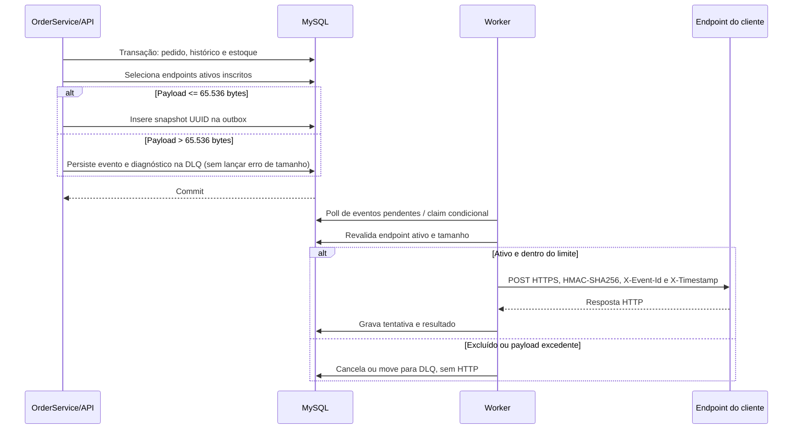

# RFC: Webhooks de saída para mudanças de status de pedidos

| Campo | Valor |
| --- | --- |
| ID | RFC-webhooks-pedidos |
| Status | Draft |
| Autor | Não confirmado |
| Data | 2026-11-02 |
| Revisores | A definir; revisão de segurança por Sofia foi informada como necessária antes do deploy |
| Documentos relacionados | [docs/PRD.md](../PRD.md), [TRANSCRICAO.md](../../TRANSCRICAO.md), [docs/TRACKER.md](../TRACKER.md) |

## 1. Resumo executivo

Este RFC propõe adicionar webhooks outbound ao OMS para informar clientes B2B sobre mudanças elegíveis de status de pedidos. A proposta usa Transactional Outbox no MySQL existente, um worker Node.js separado, entrega HTTPS assíncrona, assinatura HMAC-SHA256 e semântica at-least-once. O escopo e as decisões de produto/técnicas originalmente acordadas estão descritos no PRD e na transcrição; este RFC incorpora as diretrizes adicionais informadas pelo usuário durante sua elaboração.

A proposta recomendada provisoriamente preserva o estilo modular e os mecanismos existentes. Para autorização, este RFC define como fonte de verdade uma relação persistida `CustomerMembership` no MySQL, consultada em cada operação com a identidade do JWT e o cliente do recurso; concessões e revogações devem ocorrer por provisionamento administrativo confiável, sem autoassociação. A relação ainda precisa ser implementada e a proposta aprovada formalmente. Também são propostas o soft delete dos webhooks com cancelamento de eventos ainda não iniciados e a classificação imediata de payloads acima de 65.536 bytes como falha permanente em DLQ. O replay conserva o `event_id` de negócio, cria identificador independente por tentativa e recalcula a assinatura usando a secret ativa no instante do envio.

O documento não afirma que a feature esteja implementada nem que a proposta tenha sido aceita formalmente pela equipe. O status permanece `Draft`. A recomendação não substitui a decisão formal dos revisores.

## 2. Contexto e problema

**Informado na transcrição:** três clientes B2B pediram notificações sobre mudanças de status; atualmente consultam `GET /orders` repetidamente, o que torna suas integrações mais lentas e caras. Foi relatado risco comercial ligado ao prazo de atendimento. A reunião rejeitou chamadas HTTP síncronas no fluxo de atualização, pois a indisponibilidade de endpoints externos não deve bloquear a operação de pedidos ([TRANSCRICAO.md](../../TRANSCRICAO.md#L1-L40)).

**Confirmado no código:** `OrderService.changeStatus()` já opera numa transação Prisma que atualiza status, grava histórico e pode debitar ou repor estoque ([order.service.ts](../../src/modules/orders/order.service.ts#L126-L171)). O schema Prisma define MySQL e não contém modelos de webhook, outbox, histórico de entrega ou DLQ ([schema.prisma](../../prisma/schema.prisma#L1-L25)). A integração de webhook é, portanto, futura.

A solução precisa preservar a atomicidade entre mudança do pedido e registro do evento, desacoplar latência de terceiros, permitir diagnóstico e replay controlado, e evitar acesso cruzado entre clientes. O tempo inferior a 10 segundos é objetivo para operação normal, não SLA garantido; backlog, indisponibilidade, retentativas e duração do processamento podem excedê-lo ([PRD.md](../PRD.md), seções “Objetivos e métricas” e “Requisitos não funcionais”).

## 3. Objetivos

- Notificar por HTTPS os endpoints ativos inscritos no status de destino.
- Registrar de forma atômica os eventos elegíveis com a mudança de status, histórico e efeitos de estoque.
- Não deixar a chamada a endpoint de cliente participar da requisição ou transação HTTP da API.
- Assinar cada envio com HMAC-SHA256 e secret exclusiva do endpoint, suportando rotação e revogação.
- Oferecer histórico de tentativas, DLQ e replay administrativo auditável, preservando a identidade imutável do evento.
- Autorizar operações de gestão pelo vínculo explícito entre usuário autenticado e cliente, sem confiar somente no `customer_id` enviado.
- Tratar payload maior que 65.536 bytes sem enviar, truncar ou fragmentar, preservando a falha para diagnóstico sem fazer do excesso de tamanho uma exceção de negócio que reverta a mudança do pedido.
- Reutilizar Node.js/TypeScript, MySQL, Prisma, autenticação JWT, `requireRole`, AppError, validação Zod e logging Pino existentes, evitando infraestrutura adicional nesta versão.

## 4. Não objetivos

- Receber webhooks inbound de clientes.
- Garantir exactly-once ou ordenação global.
- Rodar múltiplos workers paralelos na primeira versão.
- Introduzir Redis, broker dedicado, painel visual, notificações por e-mail ou rate limiting de saída nesta fase.
- Arquivar entregas após 30 dias nesta fase.
- Conceder ou revogar vínculos usuário-cliente por autoatendimento; o provisionamento fica restrito a um fluxo administrativo confiável.
- Transformar a meta de menos de 10 segundos em garantia absoluta.

## 5. Situação atual (As-Is)

- **Confirmado:** projeto Node.js/TypeScript, Express, Prisma e MySQL. Os scripts do pacote têm `build` e testes Vitest, mas não há script `worker` atualmente ([package.json](../../package.json#L1-L20)).
- **Confirmado:** o fluxo `changeStatus()` atual lê o pedido, valida transições, atualiza estoque quando necessário, atualiza status, grava `OrderStatusHistory` e retorna os dados atualizados dentro da transação ([order.service.ts](../../src/modules/orders/order.service.ts#L126-L171)). Não há gravação de evento webhook nesse fluxo.
- **Confirmado:** `authenticate` valida JWT e popula `req.user` com `id`, `email` e `role`; `requireRole` limita por `ADMIN`/`OPERATOR` ([auth.middleware.ts](../../src/middlewares/auth.middleware.ts#L6-L58)).
- **Confirmado:** o modelo `User` não possui relação de vínculo com `Customer`; `Customer` possui relação com pedidos, não com usuários ([schema.prisma](../../prisma/schema.prisma#L25-L53)). Assim, a autorização por cliente não é capacidade atualmente demonstrada.
- **Confirmado:** não há módulo de webhook, worker, esquema de outbox nem DLQ no código/schema consultados. O PRD descreve a feature como proposta.
- **Informado na transcrição:** reutilizar a infraestrutura existente, usar worker separado com PrismaClient próprio, polling de 2 segundos e tabela outbox no MySQL em vez de broker dedicado ([TRANSCRICAO.md](../../TRANSCRICAO.md#L44-L80), [TRANSCRICAO.md](../../TRANSCRICAO.md#L172-L180)).

## 6. Requisitos e restrições

### Requisitos funcionais e de segurança

1. CRUD de configurações, consulta de histórico e rotação exigem JWT válido e autorização do usuário para o cliente associado. `customer_id` informado pela requisição é identificador de recurso, não prova de permissão.
2. O envio outbound não usa JWT. O destinatário verifica origem e integridade por HMAC-SHA256, secret exclusiva por endpoint. HTTPS é obrigatório.
3. Replay manual é restrito a `ADMIN`, com auditoria do administrador e resultado da operação.
4. Cada mudança elegível produz snapshot JSON com UUID imutável de negócio e evento por endpoint inscrito.
5. A entrega é at-least-once. Cada tentativa possui identificador próprio (`attempt_id`/`delivery_id`); todas reutilizam o `event_id` original em `X-Event-Id`.
6. O worker verifica estado ativo antes de começar envio. Soft delete registra `deleted_at` e, quando disponível, `deleted_by`; impede novas inserções e cancela eventos pendentes/em retry com status `CANCELLED`. Entregas concluídas e DLQ permanecem para auditoria; DLQ não pode ser reproduzida enquanto o webhook está excluído.
7. Um HTTP já iniciado pode concluir. Eventos ainda não despachados devem ser cancelados. A coordenação concorrente entre exclusão e despacho é descrita na seção 12.
8. O limite é 65.536 bytes da serialização JSON em UTF-8. Excesso é falha permanente `WEBHOOK_PAYLOAD_TOO_LARGE`, sem HTTP, truncamento, fragmentação ou retry, e deve ser persistido na DLQ com payload original, `event_id`, tamanho observado, limite, motivo e timestamp.
9. Replay valida novamente ativo e tamanho. Excesso mantém o item na DLQ e a API retorna `WEBHOOK_PAYLOAD_TOO_LARGE`.
10. Rotação gera secret nova exclusiva e torna-a ativa imediatamente para todos os envios novos, inclusive retries de eventos antigos. A secret anterior fica válida para verificação do destinatário durante 24 horas e é então invalidada. Comprometimento requer revogação imediata, sem janela de graça.
11. `X-Timestamp` representa a tentativa atual; timestamp/evento no corpo e payload snapshot não mudam no replay. HMAC é recalculado no envio com a secret ativa.

### Restrições e objetivos quantitativos

- Polling proposto: 2 segundos. Objetivo de iniciar entrega em menos de 10 segundos em operação normal; não é garantia.
- Timeout HTTP: 10 segundos.
- Falhas transitórias: até cinco retries adicionais à tentativa inicial, com intervalos de 1 minuto, 5 minutos, 30 minutos, 2 horas e 12 horas; após isso, DLQ.
- Máximo do corpo serializado: 65.536 bytes, cálculo UTF-8. Não foi definida meta p95, disponibilidade mensal, volume sustentado ou throughput máximo.
- Uma instância worker na primeira versão; ordenação de recebimento não é garantida em falhas e retries.
- Revisão de segurança antes do deploy foi informada como dependência organizacional; a transcrição reserva ao menos dois dias úteis para a revisão ([TRANSCRICAO.md](../../TRANSCRICAO.md#L282-L289)).

### Classificação das afirmações

Os requisitos-base acima são **Informados no PRD/transcrição** ou **Confirmados no código**, conforme referências. O modelo `CustomerMembership`, sua consulta por operação e seu provisionamento administrativo, assim como as políticas de rotação imediata, soft delete, DLQ para payload excessivo, identidade do replay e identificador por tentativa, são **diretrizes adotadas para esta proposta durante esta elaboração**; não aparecem como decisões na transcrição original nem como implementação no código. Portanto, descrevem o To-Be proposto, não comportamento existente nem aprovação formal.

## 7. Proposta técnica (To-Be)

### Componentes

- Novo módulo `src/modules/webhooks` para configuração, consulta de entregas, rotação e replay, seguindo padrão controller/service/repository/routes/schemas.
- Modelos MySQL/Prisma para configuração do endpoint, outbox, entregas/tentativas, DLQ e auditoria de replay/exclusão/rotação. O desenho físico, índices e retenção precisam ser detalhados no FDD.
- Relação MySQL/Prisma `CustomerMembership` entre usuário e cliente, com estado ativo/revogado, chaves estrangeiras e unicidade por par usuário-cliente. Ela é a fonte autoritativa proposta para autorização por recurso; concessão e revogação ficam em provisionamento administrativo confiável e auditável, sem fluxo de autoassociação.
- `src/worker.ts` como entry point separada, com PrismaClient próprio e polling em batches pequenos.
- Integração no `OrderService.changeStatus()` para consultar endpoints ativos elegíveis, montar o snapshot e persistir o registro na mesma transação.
- Em cada operação de gestão, consulta de histórico ou rotação, a API valida a identidade autenticada (`req.user.id`, derivada do JWT) junto ao `customer_id` do recurso contra um vínculo ativo em `CustomerMembership`. A ausência de vínculo resulta em negação; `customer_id` recebido e claims do JWT, isoladamente, não autorizam acesso. A checagem deve ocorrer no servidor em cada operação, sem depender de vínculo potencialmente desatualizado no token.
- Worker que serializa o snapshot uma vez, mede bytes UTF-8, verifica configuração ativa, assina o corpo final e realiza POST HTTPS com timeout de 10 segundos.

### Fluxo de status e outbox

### Recomendação provisória para payload excedente

Validar no produtor após formar o JSON snapshot e antes de encaminhar à persistência da entrega, contando os bytes da serialização UTF-8. Para snapshot excedente, gravar diretamente na DLQ na mesma transação que registra a mudança de pedido, com o evento/payload original e diagnóstico; não lançar exceção por `WEBHOOK_PAYLOAD_TOO_LARGE`. O evento não entra no conjunto de entrega/retry e o worker não faz request HTTP. Revalidar também no worker como defesa em profundidade, antes do envio, e no endpoint de replay.

A mudança de tamanho em si não reverte pedido, histórico ou estoque. A persistência de evento/DLQ permanece no limite transacional para impedir perda silenciosa de rastreabilidade. Uma falha de banco ao gravar esse registro continua sendo falha de persistência e pode abortar a transação: isso é distinto do resultado de validação de payload. Se o requisito de negócio também proibir rollback quando a própria persistência da DLQ falhar, será necessário decidir entre uma estratégia durável alternativa (por exemplo, gravar o evento válido na outbox e promover a DLQ assincronamente) e aceitar consistência eventual; isso não está confirmado.

### Rotação e entrega

A operação autenticada e autorizada gera a secret nova e atualiza atomicamente a secret ativa. Novas entregas e retries carregam a secret ativa no momento em que o request é construído, nunca uma secret congelada no snapshot. O receptor deve aceitar assinaturas da secret nova e, por até 24 horas, da anterior. A plataforma não consegue controlar o lado receptor; pode retornar a secret nova uma única vez e orientar o cliente a instalá-la antes de solicitar rotação. A ativação imediata implica possível falha de entrega se o consumidor ainda não tiver configurado a nova secret.

Para comprometimento, propõe-se uma ação explícita de revogação emergencial que invalida a secret antiga imediatamente e requer ou ativa uma nova secret sem período de sobreposição. Nome de rota, autorização, semântica de requests já iniciados e entrega da secret de substituição serão definidos no detalhamento; a capacidade não deve ser confundida com a rotação normal de 24 horas.

### Replay e identidade

Replay reusa exatamente o payload snapshot e `event_id` original; não cria novo evento de negócio. Cria novo `attempt_id`/`delivery_id`, atualiza `X-Timestamp` para a tentativa atual e recalcula HMAC com a secret ativa. Antes da alteração, uma transação/controle concorrente verifica que o registro DLQ existe, ainda não está sendo reproduzido, webhook está ativo e payload permanece dentro do limite. O resultado, solicitante, horário e ID da tentativa ficam auditáveis. Erro de tamanho retorna `WEBHOOK_PAYLOAD_TOO_LARGE` e preserva o registro DLQ sem mutação destrutiva.

## 8. Alternativas consideradas

### Transporte de eventos

1. **Transactional Outbox MySQL + worker (recomendação provisória).** Grava snapshot junto da mudança e um processo separado faz polling/envio. Aproveita o banco e as transações já existentes.
2. **Broker dedicado (por exemplo, Redis Streams).** A aplicação publica ou encaminha eventos a um serviço de mensageria e workers consomem. Pode oferecer desacoplamento e opções de escala, mas introduz infraestrutura, operação, observabilidade e problema de dual-write se publicação e transação MySQL não forem coordenadas.
3. **Envio síncrono no fluxo de mudança.** Chama o endpoint durante a operação de status. Menos componentes assíncronos, porém acopla disponibilidade/latência externa à transação e pode bloquear o domínio; rejeitado na reunião como incompatível com o objetivo operacional.
4. **Manter o comportamento atual.** Não enviar notificações e deixar clientes consultarem a API. É a referência de menor alteração, mas não atende a necessidade de negócio comunicada.

### Autorização de gestão

1. **Vínculo explícito usuário-cliente (proposta definida neste RFC).** Autenticar por JWT e validar em cada operação uma associação ativa em `CustomerMembership` para a identidade autenticada (`req.user.id`) e o `customer_id` do recurso. A tabela MySQL é a fonte de verdade proposta; concessão/revogação é administrativa e não há autoassociação. O schema atual não contém essa tabela, portanto a regra está definida no desenho, mas depende de implementação.
2. **Qualquer usuário autenticado.** Reaproveita diretamente `authenticate`, mas não impede que usuário autenticado altere recursos de clientes não relacionados se conhecer um ID.
3. **Somente `ADMIN` para todo o CRUD.** É simples com `requireRole`, mas centraliza operação nos administradores e não atende adequadamente à autonomia dos usuários dos clientes. Replay da DLQ permanece `ADMIN` em todas as alternativas.

### Momento da validação de payload

1. **Na criação do snapshot (recomendado), com defesa adicional no worker/replay.** Permite encaminhamento imediato à DLQ e evita que evento conhecido como inválido percorra retries. Requer serialização e verificação consistentes na API.
2. **Somente no worker.** Mantém a mudança de pedido desacoplada da serialização completa, mas o evento inválido permanece na outbox até ser processado e exige transição posterior para DLQ. Um worker indisponível atrasa a classificação e o diagnóstico.
3. **Somente no envio/replay.** Não é suficiente: permite tentativa de processamento sem validar tamanho antes de preparar o request e deixa caminho de replay vulnerável a nova tentativa proibida.

### Exclusão

- **Soft delete com cancelamento (diretriz escolhida).** Mantém rastreabilidade, bloqueia novas inserções/envios e cancela pendentes, preservando entregues e DLQ.
- **Hard delete.** Simplifica o estado ativo/inativo, mas perde referência de auditoria e complica FK/histórico/eventos pendentes; não atende às regras escolhidas.

### Rotação

- **Ativação imediata da nova secret (diretriz escolhida).** Reduz o período de uso de uma chave possivelmente comprometida; traz risco de falhas enquanto o receptor não atualiza.
- **Ativação após confirmação do receptor ou período de preparação.** Reduz falhas de configuração do destinatário, mas mantém a chave antiga como signatária por mais tempo. Não escolhida para a proposta.

## 9. Comparação de alternativas e trade-offs

| Critério | Outbox MySQL + worker | Broker dedicado | Síncrono |
| --- | --- | --- | --- |
| Atomicidade com pedido | Alta: mesma transação no banco; requer persistência dos endpoints elegíveis junto do pedido | Não é automática: precisa coordenação/relay para evitar dual-write | Baixa: HTTP externo não participa atomicamente do MySQL |
| Infraestrutura/operação | Reusa MySQL; adiciona processo worker, polling e manutenção de tabelas | Maior: broker, credenciais, deploy e observabilidade próprios | Menor quantidade de componentes, maior acoplamento de disponibilidade |
| Latência | Poll de 2 s é objetivo, não garantia; backlog e falhas aumentam | Potencialmente menor que polling, depende de topologia e consumidor | Baixa em sucesso rápido; timeout externo degrada pedido |
| Reprocessamento | Estado e tentativas controláveis por tabelas | Ferramentas de broker variam; DLQ ainda precisa política | Requer fila de compensação para falhas, que reintroduz arquitetura assíncrona |
| Compatibilidade atual | Alta: Prisma/MySQL e transação já usados | Média/baixa: infraestrutura não localizada | Baixa para requisito de não bloquear o fluxo |

| Critério | Vínculo explícito | Qualquer autenticado | Só ADMIN |
| --- | --- | --- | --- |
| Isolamento entre clientes | Melhor alinhamento: exige checagem de autorização por recurso | Fraco: identidade autenticada não prova acesso ao `customer_id` | Forte se admin for equipe confiável, mas não modela autonomia do cliente |
| Complexidade | Média: requer nova relação persistida e provisionamento administrativo | Baixa inicialmente, alto risco de autorização indevida | Baixa/moderada com `requireRole`; pode aumentar carga operacional |
| Compatibilidade | Reusa autenticação, precisa complementar autorização por recurso | Compatível com middleware atual, mas insuficiente para requisito | Compatível com `requireRole`, sem mudança de modelo de identidade |
| Manutenção | Regra explícita e escalável, se relação for governada | Simples até haver acesso indevido; auditoria difícil por cliente | Fácil de entender, operacionalmente centralizada |

**Trade-off principal recomendado provisoriamente:** a outbox e a relação `CustomerMembership` adicionam estado, migração e trabalho de provisionamento, mas reduzem acoplamento com sistemas externos e evitam confiar em `customer_id` fornecido pelo cliente. A fonte e a regra de autorização estão definidas nesta proposta; a implementação da relação e a aprovação formal continuam pendentes.

## 10. Impactos arquiteturais e integrações

- **Pedidos:** `OrderService.changeStatus()` precisará selecionar webhooks ativos por `customer_id` e status de destino e persistir evento/snapshot ou DLQ no mesmo contexto transacional. O serviço atual já recebe `Prisma.TransactionClient` implicitamente pela transação; não há ainda lógica de publicação.
- **Persistência:** novas tabelas/modelos e migration Prisma para configuração, outbox, tentativa/histórico, DLQ, exclusão e auditoria. Definir índices por status/data, FK e políticas de retenção no FDD. O modelo atual não contém essas entidades.
- **Processos:** adicionar entry point e comando worker; cada processo terá seu próprio PrismaClient conforme a decisão registrada na transcrição. API e worker compartilham banco e configuração de conexão.
- **HTTP/API:** rotas de CRUD, listagem por cliente, deliveries (até 100), rotação, rota administrativa de replay e possivelmente revogação emergencial. A API já agrega routers sob `/api/v1`; decidir compatibilidade/rota exata no FDD.
- **Autorização:** integrar `authenticate` em todos os endpoints de gestão e consultar `CustomerMembership` para autorizar o cliente do recurso. A role, sozinha, não substitui esse vínculo nem concede bypass implícito em operações por cliente. O replay continua restrito a `ADMIN` e auditado, conforme requisito existente. A tabela ainda precisa ser adicionada ao Prisma e o provisionamento administrativo implementado conforme a regra definida.
- **Cliente B2B:** recebe POST HTTPS com `X-Event-Id`, `X-Webhook-Id`, `X-Signature`, `X-Timestamp`, JSON; valida HMAC e deduplica pelo `event_id`.
- **Observabilidade:** Pino já está disponível; logs estruturados devem registrar IDs, resultado, tamanho e estado, não secret nem payload sensível em claro. Métricas/tracing não estão definidos na origem.

## 11. Segurança, observabilidade e operação

### Autorização e transporte

- JWT é usado apenas para operações da API; os webhooks outbound não usam JWT. A integridade/autenticidade do request é validada pelo destinatário com HMAC-SHA256.
- Verificar vínculo usuário-cliente no servidor para cada CRUD, histórico e rotação; IDs enviados não são credenciais. O replay permanece exclusivamente ADMIN e auditado.
- A fonte de autorização proposta é `CustomerMembership` no MySQL. A consulta deve confirmar o par `user_id`/`customer_id` e estado ativo em cada operação; falhar fechado quando inexistente/revogado. Concessões e revogações não são self-service e devem ser feitas por fluxo administrativo confiável, com registro do ator e horário.
- HTTPS obrigatório. A URL é controlada pelo usuário e gera chamada server-side. **Risco inferido a validar na revisão de segurança:** SSRF ou resolução para endereços internos/privados. Avaliar bloqueio de IPs reservados, revalidação DNS no momento do envio, redirects desabilitados ou revalidados, e controles de egress compatíveis com o ambiente; a transcrição/PRD não especifica esses controles.
- Secrets exclusivas por endpoint, não registrar nos logs, devolver de forma controlada e definir armazenamento protegido em repouso. Criptografia/gestão de segredo não está definida no workspace e deve ser validada sem pressupor serviço de vault já existente.
- Rotação normal ativa a nova secret imediatamente. Para mitigar falha de entrega pelo receptor desatualizado: retornar a nova secret somente na resposta segura da rotação; instruir o cliente a preparar verificação com chave atual e anterior; disponibilizar aviso/etapa de confirmação antes de solicitar rotação, se compatível com ativação imediata; comunicar que retries usarão a nova secret; expor erros de assinatura/resposta no histórico sem revelar secrets. Isso reduz risco, mas não garante que o receptor foi atualizado.
- Revogação emergencial invalida sem grace period. A política para requests já iniciados e o mecanismo operacional de distribuição da nova chave precisam ser detalhados.

### Observabilidade e auditoria

- Log estruturado com `event_id`, `webhook_id`, `attempt_id`, customer, estado, código de erro, duração, bytes e timestamp; não incluir secret, assinatura sensível nem corpo completo por padrão.
- Registrar tentativas e respostas em armazenamento de histórico com limite de exposição de dados; o PRD propõe as últimas 100 entregas por webhook.
- Auditoria de replay: administrador, horário, registro DLQ, tentativa e resultado. Auditoria de soft delete: data e, quando disponível, usuário responsável. Registrar rotação/revogação sem valor da secret.
- Logs não substituem histórico transacional; falha de escrita de log não deve ser a única forma de preservar prova da DLQ/replay.
- Definir alarmes operacionais e métricas (idade do evento mais antigo, backlog, sucesso/falha por endpoint, volume DLQ, falhas de conexão) no detalhamento; métricas/tracing ainda não foram requisitos confirmados.

### Retenção e operação

- Retenção de entregas, DLQ e auditoria não foi estabelecida além de “últimas 100” no endpoint e exclusão de arquivamento em 30 dias do escopo atual. Especificar se histórico retém somente 100 registros ou se a API limita resposta a 100.
- Um único worker evita paralelismo inicial, porém cria limite de throughput e ponto operacional único; monitorar heartbeat e backlog. Não declarar disponibilidade mensal sem meta aprovada.

## 12. Estratégia de implementação, migração e rollback

### Etapas propostas

1. **Resolver bloqueadores antes do código:** implementar e validar `CustomerMembership` e seu provisionamento administrativo; decidir armazenamento/retorno seguro de secrets, mecanismo de revogação, status/estados de tentativa e a semântica de bloqueio concorrente da exclusão.
2. **Schema/migration:** adicionar configurações, outbox, deliveries, DLQ, auditoria, `deleted_at`/`deleted_by`, secret atual e secret anterior com expiração (ou representação equivalente). Índices/constraints para polling, idempotência e replay concorrente.
3. **Persistência transacional:** integrar evento elegível com `changeStatus`; criar snapshot com UUID; para excesso, registrar DLQ sem lançar erro de validação de tamanho; preservar evento/transação.
4. **API:** CRUD, listagem, deliveries, rotação e replay, com JWT, autorização por recurso, validação HTTPS, `requireRole('ADMIN')` para replay e auditoria.
5. **Worker:** processo separado e polling de 2 segundos; claim condicional, checagem do webhook, validação UTF-8, HMAC, HTTP timeout, retries, estados terminais, DLQ e logs redigidos.
6. **Validação:** testes unitários, integração transacional, testes de concorrência, segurança e cenário de replay; revisão de segurança antes de deploy.
7. **Rollout:** aplicar migration compatível; implantar API e worker inicialmente com envio desabilitado ou configuração controlada; habilitar em ambiente de teste com endpoint receptor; ativar para clientes gradualmente, acompanhando erros, backlog e DLQ. O mecanismo de feature flag/rollout não está confirmado e deve ser escolhido pela equipe.

### Exclusão versus worker concorrente

A exclusão deve ocorrer em transação: marcar endpoint inativo/soft-deleted, cancelar linhas pendentes e aguardando retry, e impedir novas inserções. O replay bloqueia se endpoint estiver excluído. O worker deve fazer claim condicional da linha apenas se o webhook permanecer ativo; imediatamente antes do HTTP, revalidar o estado.

**Mecanismo proposto para reduzir a corrida:** serializar o início do despacho e a exclusão por lock/atualização condicional no registro do webhook e mudança atômica do estado da entrega (`PENDING`/`RETRY` → `DISPATCHING`). A transação da exclusão bloqueia/atualiza o mesmo registro e cancela tudo que ainda não atingiu `DISPATCHING`. Definir `DISPATCHING` como ponto de linearização para a exceção “requisição iniciada”; após esse ponto a chamada pode concluir e seu resultado fica no histórico. Essa definição operacional deve ser revisada, pois há uma janela pequena entre gravar a reserva e abrir a conexão HTTP. Se o requisito exigir correspondência literal com o primeiro byte enviado, avaliar lock compartilhado mantido até início efetivo do request, medindo custo de lock e timeout; não manter uma transação aberta durante toda a resposta externa. Testes concorrentes devem provar que exclusão commitada primeiro impede despacho posterior.

### Rollback

- Migration deve permitir rollback de deploy sem apagar histórico. Não remover fisicamente configurações/eventos durante rollback.
- Desabilitar worker interrompe novos envios, mas mantém eventos persistidos para retomada; isso pode gerar backlog.
- Se a nova integração do `changeStatus` causar regressão, retirar a criação de eventos mantendo schema/dados até correção. Não apagar DLQ nem tentativas.
- Plano operacional para secret comprometida é revogar imediatamente e ativar substituta; não usar rollback de aplicação para revalidar secret comprometida.
- A estratégia final de migração/rollback e feature flag precisa ser validada pela equipe de deploy, pois manifests de produção não foram encontrados no contexto consultado.

## 13. Riscos, premissas e mitigação

| Risco/premissa | Impacto | Mitigação proposta / estado |
| --- | --- | --- |
| Vínculo usuário-cliente ausente no modelo atual | Acesso cruzado ou bloqueio de lançamento | A fonte proposta é `CustomerMembership`; ainda é dependência de implementação. Criar e provisionar a relação por fluxo administrativo, negar vínculo ausente/revogado e testar acesso cruzado; não confiar em `customer_id`. |
| Cliente ainda não confia na secret nova após rotação | HMAC recusado e retries/DLQ | Aviso e resposta segura na rotação; preparar receptor para duas chaves; telemetria de rejeição; documentar que retries usam chave nova. Não há garantia de atualização remota. |
| Secret comprometida | Falsificação de evento ao endpoint | Revogação emergencial sem graça, secret exclusiva, HMAC, proteção em repouso e sem logging de valores. Procedimento detalhado pendente. |
| Corrida soft delete/worker | Envio depois da exclusão ou cancelamento de request já iniciado | Claim condicional e serialização sobre o mesmo webhook; ponto de linearização `DISPATCHING`; teste concorrente e medição de lock. |
| Payload excessivo | Evento sem entrega ou DLQ sem registro | Contagem exata do JSON UTF-8 no produtor, worker e replay; persistir original e diagnóstico; não gerar retry. Falha de banco de persistência permanece falha transacional. |
| Replay duplicado concorrente | Múltiplas chamadas/retries para mesma DLQ | Claim exclusivo/transação, `replay_started_at` ou estado equivalente e constraint/idempotência; preservar `event_id`, novo `attempt_id`. |
| Endpoint lento/indisponível | Atraso e DLQ | Timeout 10 s, cinco retries adicionais nos intervalos confirmados e DLQ; replay não garante sucesso. |
| SSRF por URL de destino | Acesso a rede interna/serviços não pretendidos | Validação de URL/IP, DNS, redirects e egress a definir com segurança; HTTPS sozinho não cobre esse risco. |
| Entrega duplicada ou fora de ordem | Consumidor processa evento repetido ou estado antigo | `event_id` imutável e deduplicação no receptor; documentar ausência de garantia absoluta de ordenação. |
| Worker único/backlog | Atraso > objetivo de 10 s | Métricas/alertas de backlog e idade; objetivo não é garantia. Escala multi-worker fica fora desta versão. |
| DLQ/auditoria falha ao persistir | Perda de diagnóstico ou rollback do domínio | Outbox/DLQ na mesma transação quando viável; error path operacional. Validar o que fazer se banco indisponível, sem prometer persistência impossível. |

## 14. Estratégia de validação e critérios de sucesso

### Testes

- **Unitários:** elegibilidade por status; serialização e limite UTF-8 em bordas 65.535/65.536/65.537 bytes; HMAC e rotação; secret ativa em retry; janelas/expiração; política de cancelamento; estados/retry; assinatura e timestamp de tentativa; redaction de logs.
- **Integração transacional:** pedido, histórico, estoque e evento elegível commitam juntos; falha real de persistência de outbox reverte conforme a garantia; payload acima do limite é persistido como DLQ e não causa rollback por ser excessivo; nenhuma configuração elegível significa nenhum registro.
- **Worker/HTTP:** HTTPS, headers, timeout, resposta, falha transitória, ausência de HTTP para payload grande, validação antes de retry, secret ativa após rotação e `X-Timestamp` atual com payload original.
- **Autorização:** sem JWT, JWT inválido, vínculo ativo, vínculo ausente/revogado, tentativa com `customer_id` de terceiro e ADMIN/non-ADMIN no replay. Verificar que consulta a `CustomerMembership` ocorre por recurso e que a role não substitui o vínculo para operações de cliente.
- **Exclusão concorrente:** worker e API disputam início de entrega; exclusão primeiro cancela e impede chamada; request já marcado como iniciado pode concluir; deliveries concluídas e DLQ permanecem; replay é recusado quando excluído.
- **Replay:** mesmo `event_id` e payload snapshot; novo `attempt_id`; nova assinatura e timestamp; verificação de tamanho/estado; excesso mantém DLQ e retorna `WEBHOOK_PAYLOAD_TOO_LARGE`; dois replays simultâneos produzem no máximo uma nova tentativa ativa.
- **Segurança:** revisão de HMAC, geração/armazenamento de secrets, revogação imediata, logs e defesa contra SSRF.

### Critérios de sucesso propostos

- Zero mudança de status elegível commitada sem registro durável correspondente (outbox ou DLQ, conforme a validação de tamanho).
- Payload acima de 65.536 bytes nunca resulta em chamada HTTP, truncamento ou retry; registro DLQ contém todos os dados de diagnóstico exigidos.
- Replay não altera `event_id` nem payload; tentativa tem ID único, administrador identificado e resultado registrado.
- Após soft delete commitado, nenhum evento ainda não despachado inicia chamada; preservam-se histórico entregue e DLQ.
- Endpoints de gestão permitem acesso somente com vínculo ativo em `CustomerMembership` para o cliente do recurso; vínculo ausente ou revogado é negado, mesmo que o usuário conheça o `customer_id`.
- Medir latência de confirmação até início da primeira tentativa; objetivo <10 s em operação normal sem convertê-lo em garantia/SLA.
- A equipe define métricas/limites operacionais e ambiente de teste antes do rollout; volume, p95 e disponibilidade não estão especificados.

## 15. Perguntas abertas e decisões pendentes

1. **Fechado como decisão de desenho deste RFC:** `CustomerMembership` persistida no MySQL é a fonte autoritativa proposta. Cada operação consulta o par usuário autenticado/cliente do recurso e exige vínculo ativo; concessões e revogações são administrativas, sem autoassociação. A relação ainda não existe no schema, então implementação, provisionamento e testes de autorização são dependências de entrega, não perguntas abertas de desenho.
2. Qual formato de armazenamento em repouso e entrega única para secrets atende aos mecanismos já disponíveis? Existe chave de aplicação configurada ou proteção operacional equivalente? Não confirmado.
3. Qual contrato/rota autoriza revogação emergencial, e o que fazer com tentativas HTTP já iniciadas sob a secret revogada?
4. A persistência de payload grande diretamente na DLQ junto da transação de pedido é aceita mesmo que uma falha de banco na escrita da DLQ aborte a transação? Se não, deve-se optar por outbox intermediária e promoção assíncrona, aceitando consistência eventual.
5. Como o sistema determina com precisão o ponto entre claim do worker e início efetivo do HTTP para conciliar exclusão e request iniciado? Validar a semântica operacional proposta (`DISPATCHING`) com Product/Security.
6. Qual retenção se aplica ao histórico, DLQ, payload e auditoria, e a consulta de “últimas 100” limita só a resposta ou também armazenamento?
7. Qual volume/throughput esperado, limiar de backlog e necessidade futura de múltiplos workers? Não informado.
8. Quais controles contra SSRF, DNS rebinding e redirects são viáveis na rede de execução?
9. Como registrar eventos de falha de assinatura do destinatário? A resposta HTTP pode não distinguir assinatura inválida de outro 4xx.
10. Quem aprova formalmente o RFC e qual o prazo final? Autor/revisores e data de deploy não estão confirmados neste documento.

## 16. Recomendação provisória e justificativa

Recomenda-se provisoriamente seguir com Transactional Outbox no MySQL e worker isolado, autorização de gestão pelo vínculo explícito usuário-cliente, soft delete com cancelamento e preservação de histórico, HMAC com rotação imediata e revogação emergencial, e preservação de `event_id` através de retries/replay.

Para payload excessivo, recomenda-se calcular o tamanho UTF-8 no ponto de construção do snapshot e registrar diretamente na DLQ na mesma transação do pedido, como classificação terminal e sem lançar exceção de tamanho. Revalidar no worker e replay para defesa em profundidade. Para corrida de exclusão, usar claim/atualização condicional serializada e estado de despacho como ponto de não cancelamento, com validação concorrente antes de implementação.

A justificativa é reduzir risco de bloqueio do OMS, reutilizar MySQL/Prisma e mecanismos já presentes e explicitar a identidade do evento, auditoria e limites de autorização. A fonte e a regra de autorização usuário-cliente estão definidas como proposta neste RFC; a recomendação geral permanece **provisória** por depender da implementação/provisionamento do vínculo, da revisão de segurança, do tratamento de falha de persistência DLQ e da validação da sincronização de exclusão/despacho. A decisão de desenho sobre o vínculo pode ser formalizada no ADR-021 após revisão e aceitação.

## 17. Referências e evidências

### Código confirmado

- [src/modules/orders/order.service.ts](../../src/modules/orders/order.service.ts#L126-L171) — transação de mudança de status, estoque, histórico e retorno do pedido.
- [src/middlewares/auth.middleware.ts](../../src/middlewares/auth.middleware.ts#L6-L58) — claims do usuário, autenticação JWT e autorização `requireRole`.
- [src/shared/logger/index.ts](../../src/shared/logger/index.ts#L1-L30) — logger Pino existente e redação de campos sensíveis configurados.
- [prisma/schema.prisma](../../prisma/schema.prisma#L11-L53) — papéis, modelos User e Customer; não demonstra vínculo de usuário a cliente.
- [prisma/schema.prisma](../../prisma/schema.prisma#L1-L8) — provider MySQL e conexão Prisma.
- [package.json](../../package.json#L1-L20) — Node.js, scripts build/test; ausência de script de worker no estado consultado.

### Transcrição e documentos

- [TRANSCRICAO.md](../../TRANSCRICAO.md#L44-L80) — escolha de outbox, MySQL, polling e worker separado; ordenação esperada com worker único.
- [TRANSCRICAO.md](../../TRANSCRICAO.md#L100-L154) — retry/backoff, DLQ, replay, HMAC-SHA256, secrets por endpoint, HTTPS, limite 64 KB e at-least-once.
- [TRANSCRICAO.md](../../TRANSCRICAO.md#L172-L214) — reuso de padrões, JWT, `customer_id`, gestão por usuários autenticados e replay ADMIN.
- [TRANSCRICAO.md](../../TRANSCRICAO.md#L238-L264) — integração transacional, timeout, payload e headers.
- [TRANSCRICAO.md](../../TRANSCRICAO.md#L282-L314) — resumo e snapshot com UUID.
- [docs/PRD.md](../PRD.md) — requisitos, escopo, riscos, métricas e critérios de aceitação consolidados.
- [docs/TRACKER.md](../TRACKER.md) — rastreabilidade existente do PRD; esta atualização não pode comprovar decisões fornecidas apenas durante a entrevista atual por falta de fonte persistida permitida no tracker.

**Divergência de prazo a confirmar:** a transcrição registra que Atlas queria entrega até o fim de novembro e a estimativa discutida foi de três sprints ([TRANSCRICAO.md](../../TRANSCRICAO.md#L270-L277)); o PRD resume o risco como “até o fim do trimestre”. Este RFC não escolhe um prazo como compromisso aprovado.

### Fonte das decisões desta elaboração e lacunas de evidência

As decisões de usar `CustomerMembership` persistida no MySQL, validar o vínculo ativo em cada operação e restringir concessão/revogação a provisionamento administrativo, além da ativação imediata de secret, revogação emergencial, soft delete, cancelamento e preservação de registros, encaminhamento de payload excessivo diretamente à DLQ, resposta de replay por excesso e preservação de `event_id`, foram **adotadas para esta proposta durante a conversa de elaboração**. A conversa não está registrada em `TRANSCRICAO.md`, e essas regras não estão implementadas no código consultado. Logo, são diretrizes de desenho, não fatos do sistema nem decisões presentes na reunião original. O item de desenho está fechado neste RFC, mas rastreabilidade documental válida e aprovação formal ainda dependem de incorporar a decisão a uma fonte aprovada; o tracker não deve atribuir evidência de código a uma implementação inexistente.

## 18. Histórico de revisões

| Data | Alteração | Responsável |
| --- | --- | --- |
| 2026-11-02 | Criação do RFC em estado Draft a partir do PRD, transcrição, código consultado e diretrizes informadas durante a entrevista. | Não confirmado |
| 2026-11-14 | Definição proposta de `CustomerMembership` como fonte de autorização por cliente; sincronização do ADR-021 e registro de que a pendência de concorrência do ADR-022 permanece aberta. | Não confirmado |
