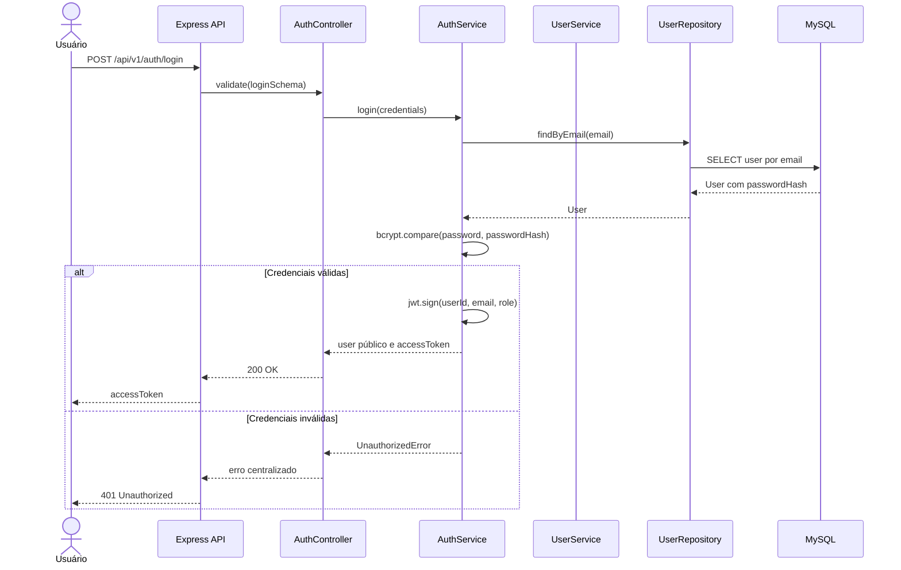
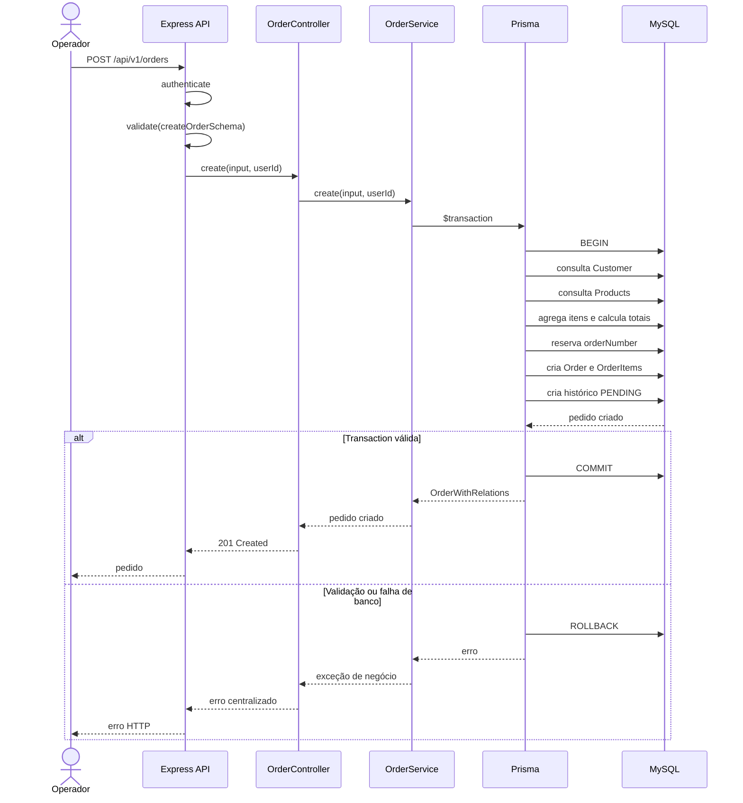
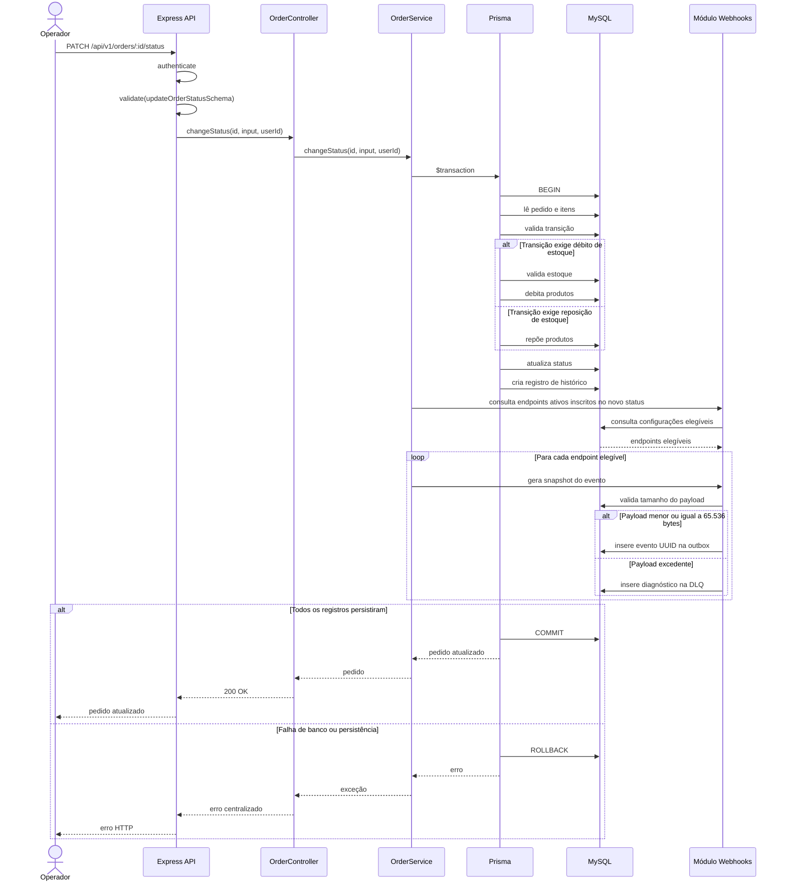
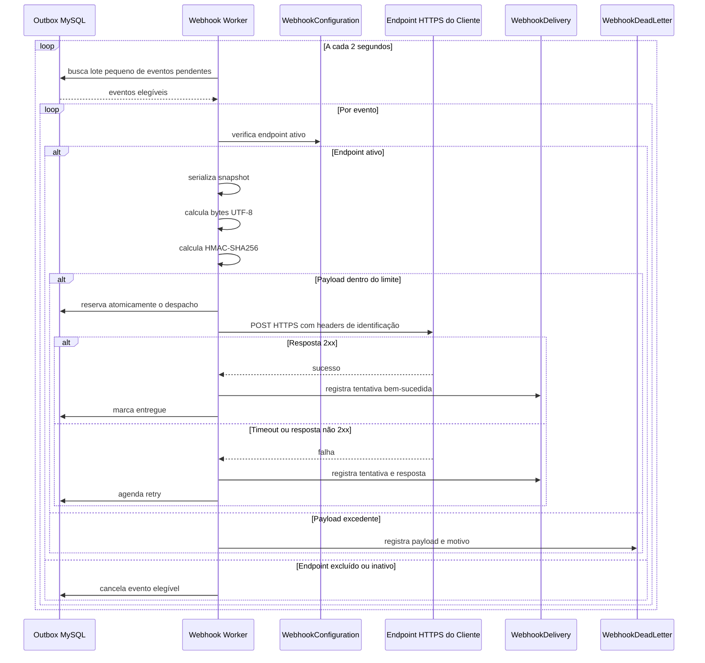
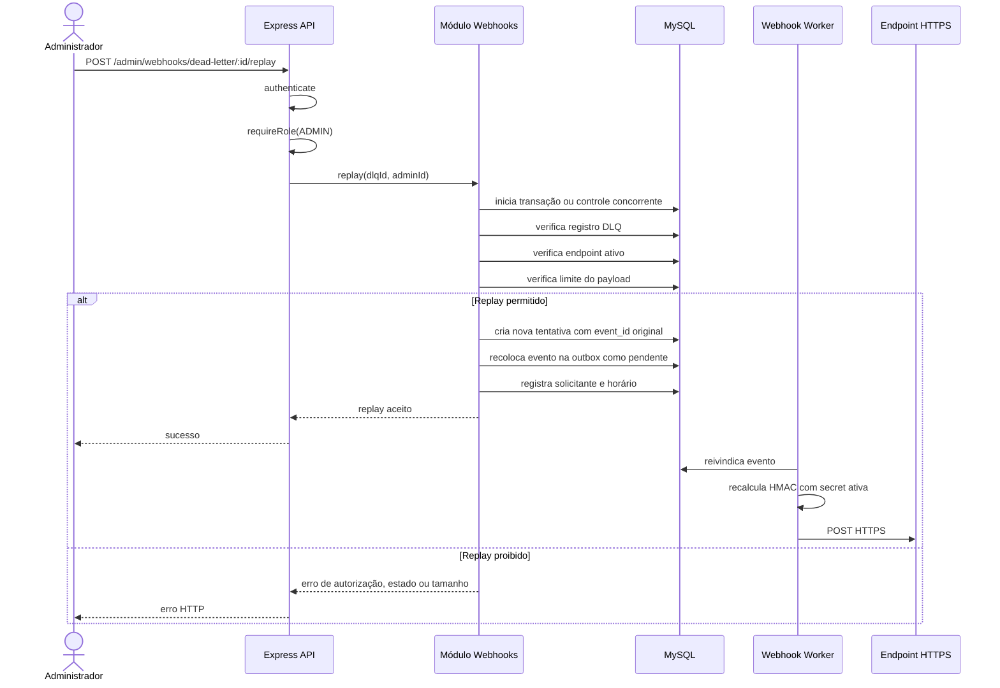

### HLD: Order Management System

Versão: 1.0
Data: 2026-11-22
Responsável: Não informado

---

### Objetivo técnico
Fornecer uma API REST modular para gestão de usuários, clientes, produtos e pedidos, mantendo a integridade transacional das operações e oferecendo notificações assíncronas para mudanças de status por meio de webhooks.

O sistema atualiza pedidos, estoque e histórico em transações MySQL e será estendido com Transactional Outbox, worker separado e entrega outbound de eventos sem bloquear as operações HTTP.

Dependências com outros sistemas
- MySQL
- Clientes externos que recebem webhooks
- Biblioteca Prisma
- JWT para autenticação

---

### Arquitetura geral
A aplicação segue uma arquitetura em camadas modular, com Express como entrada HTTP, controllers responsáveis pelas requisições, services concentrando regras de negócio, repositories encapsulando acesso a dados e Prisma como ORM.

A API expõe recursos REST versionados em `/api/v1`. Cada domínio possui controller, service, repository, schemas Zod e rotas. O acesso principal a dados utiliza o MySQL por meio de transações Prisma.

O fluxo proposto para webhooks separa o domínio da entrega externa:
- API persiste pedidos e eventos na mesma transação.
- Worker consulta a outbox em polling.
- Worker realiza POST HTTPS nos endpoints configurados.
- Falhas transitórias recebem retry com backoff.
- Falhas permanentes são registradas em DLQ.

Ambiente de implantação
- Cloud ou servidor híbrido
- API Node.js executada como processo HTTP
- Worker Node.js executado como processo separado
- MySQL 8.0 como fonte de dados principal

Tecnologias principais
- Node.js 20
- TypeScript
- Express
- Prisma
- Zod
- MySQL 8.0
- JSON Web Token
- bcrypt
- Pino
- Vitest

Padrões adotados
- Arquitetura modular por domínio
- REST versionado
- Repository Pattern
- Transactional Outbox
- At-least-once delivery
- Validação por schema Zod
- Erros padronizados com AppError
- Soft delete para configurações de webhook

---

### Componentes e responsabilidades
| Componente | Responsabilidades | Dependências |
| ----------- | ----------------- | ------------ |
| API Express | Inicializar a aplicação, configurar middleware e montar rotas REST | Middlewares, Prisma |
| Módulo Auth | Registrar usuários, autenticar credenciais e emitir JWT | UserRepository, UserService, bcrypt, JWT |
| Módulo Users | Criar e consultar usuários | Prisma, bcrypt |
| Módulo Customers | Gerenciar clientes e seus dados cadastrais | Prisma, Zod |
| Módulo Products | Gerenciar catálogo, SKU, preço e estoque | Prisma, Zod |
| Módulo Orders | Criar pedidos, controlar estoque, alterar status e listar pedidos | Prisma, Customer, Product, OrderItem |
| Middleware de autenticação | Validar Bearer token e roles ADMIN ou OPERATOR | JWT_SECRET |
| Middleware de validação | Validar params, query e body com Zod | Schemas dos módulos |
| Middleware de erros | Normalizar respostas de negócio, validação e banco | AppError, Prisma, Pino |
| Middleware de logging | Atribuir request ID e registrar requisições | Pino |
| Transactional Outbox | Persistir eventos elegíveis junto da mudança de status | MySQL, Prisma |
| Webhook Worker | Consultar outbox, enviar eventos e registrar tentativas | Prisma, MySQL, HTTP HTTPS |
| DLQ | Preservar falhas permanentes e permitir replay administrativo | Outbox, webhook configuration |
| Módulo Webhooks | Gerenciar endpoints, secret, histórico e replay | Pendente de implementação |

---

### Fluxo de requisições e de dados
**Fluxo de requisição**
- O cliente envia uma requisição HTTP para `/api/v1`.
- O middleware atribui um request ID.
- O JWT é validado quando a rota exige autenticação.
- O Zod valida parâmetros, query ou body.
- O controller delega a operação ao service.
- O service aplica regras de negócio.
- O repository ou Prisma acessa o MySQL.
- O middleware centraliza respostas de sucesso e erro.
- O Pino registra a requisição, status e duração.

**Fluxo de dados de autenticação**

**Fluxo de dados de criação de pedido**

**Fluxo de dados de mudança de status**

**Fluxo de dados de webhook**

**Fluxo de replay administrativo**

**Fluxo de dados gerais**
- Cliente ou operador → API Express.
- API → controller → service → repository ou Prisma.
- Prisma → MySQL.
- Autenticação → middleware JWT.
- Validação → schemas Zod.
- Erros → middleware centralizado.
- Mudança de pedido → outbox → worker → endpoint externo.
- Worker → delivery history ou DLQ.
- Replay administrativo → outbox → worker.

---

### Modelo de dados (alto nível)
Entidades principais
- User
- Customer
- Product
- Order
- OrderItem
- OrderStatusHistory
- OrderNumberSequence
- CustomerMembership, proposta futura
- WebhookConfiguration, proposta futura
- WebhookOutbox, proposta futura
- WebhookDelivery, proposta futura
- WebhookDeadLetter, proposta futura
- WebhookReplayAudit, proposta futura

Relações
- Customer possui zero ou vários Orders.
- User cria zero ou vários Orders.
- Order pertence a um Customer e a um User criador.
- Order possui zero ou vários OrderItems.
- OrderItem pertence a uma Order e a um Product.
- Order possui zero ou vários registros de histórico.
- OrderStatusHistory pertence a uma Order e ao User responsável pela mudança.
- CustomerMembership relaciona User e Customer, conforme proposta futura.
- WebhookConfiguration pertence a um Customer.
- WebhookOutbox pode gerar várias WebhookDelivery.
- WebhookDelivery pode produzir um registro permanente em WebhookDeadLetter.

Fonte de verdade
- MySQL é a fonte de verdade para dados transacionais e estado operacional.
- Prisma é a camada de acesso aos dados.
- Pedido, histórico e estoque são confirmados na mesma transação.
- WebhookOutbox é a fonte de verdade de eventos pendentes.
- CustomerMembership será a fonte de verdade para autorização por cliente na implementação proposta.

---

### Interfaces públicas
| Nome | Tipo | Protocolo | Exposição | SLAs/Limites |
| ---- | ---- | ---------- | --------- | ------------- |
| Health Check | API | REST GET /health | Interna | Resposta imediata |
| Autenticação | API | REST /api/v1/auth | Externa | JWT com expiração configurada |
| Usuários | API | REST /api/v1/users | Externa | Administradores para consulta por ID |
| Clientes | API | REST /api/v1/customers | Externa | Requer autenticação |
| Produtos | API | REST /api/v1/products | Externa | Requer autenticação |
| Pedidos | API | REST /api/v1/orders | Externa | Requer autenticação |
| Configuração de Webhooks | API | REST /api/v1/webhooks | Externa, futura | Requer autenticação e vínculo com cliente |
| Histórico de entregas | API | REST /api/v1/webhooks/:id/deliveries | Externa, futura | Últimas 100 entregas |
| Replay de DLQ | API | REST /api/v1/admin/webhooks/dead-letter/:id/replay | Interna ou administrativa, futura | Requer role ADMIN |
| Endpoint recebido pelo cliente | API | POST HTTPS | Externa | Timeout de 10 segundos |
| HMAC-SHA256 | SDK ou integração | Header X-Signature | Externa | Secret exclusiva por endpoint |

---

### Considerações de escalabilidade e disponibilidade
Abordagem geral
- Escala horizontal da API por instância de processo.
- Worker separado do ciclo de vida HTTP.
- Single-worker na primeira versão dos webhooks.
- Backlog controlado por polling de 2 segundos e lote pequeno.
- Ausência de garantia de ordenação global.

Técnicas aplicadas
- Índices por status e data de criação da outbox.
- Transações Prisma para atomicidade do domínio.
- Processamento assíncrono fora da transação HTTP.
- Autosscaling da API, desde que o deployment suporte múltiplas instâncias.
- Retry com backoff.
- Timeout de 10 segundos nas chamadas outbound.
- Limite de payload de 65.536 bytes.
- Caching reservado para versões posteriores.
- Particionamento por order_id reservado para escala futura.

Meta de disponibilidade
- Interfaces externas: objetivo inicial de 99.9%.
- Interfaces internas: objetivo inicial de 99.5%.
- Entrega outbound em menos de 10 segundos como objetivo operacional, não como SLA absoluto.

---

### Segurança
Autenticação
- Autenticação por Bearer JWT.
- JWT contém ID, email e role.
- Senhas persistidas com bcrypt.
- O segredo JWT possui comprimento mínimo de 16 caracteres.

Autorização
- Roles existentes: ADMIN e OPERATOR.
- Replay administrativo exige ADMIN.
- Operações sobre clientes futuras devem exigir vínculo ativo em CustomerMembership.
- O customer_id informado pela requisição não representa prova de autorização.

Proteção de dados
- HTTPS obrigatório para endpoints outbound.
- HMAC-SHA256 protege integridade e origem dos webhooks.
- Secret exclusiva por endpoint.
- Secret antiga pode permanecer válida por até 24 horas durante rotação.
- Payload máximo de 65.536 bytes em UTF-8.
- Dados sensíveis não devem aparecer em logs.
- JWT, senha, passwordHash, token e secret são redigidos pelo Pino.
- PII de clientes deve seguir políticas formais de retenção e acesso.

Gestão de segredos
- JWT_SECRET proveniente de variável de ambiente.
- DATABASE_URL proveniente de variável de ambiente.
- Secret dos webhooks deve ser gerada pela plataforma e armazenada de forma protegida.
- A secret completa deve ser revelada somente na criação ou rotação, conforme o contrato aprovado.

---

### Observabilidade
Logs
- Pino com logs estruturados.
- Registro de request ID, método, path, status HTTP e duração.
- Registro de erros não tratados pelo middleware.
- Redação de authorization, cookie, senha, hash de senha e tokens.

Métricas
- Quantidade de requisições por endpoint.
- Latência HTTP por rota.
- Taxa de erros por código.
- Eventos pendentes na outbox.
- Taxa de entrega bem-sucedida.
- Taxa de falhas transitórias.
- Quantidade de itens na DLQ.
- Tempo entre confirmação da mudança e primeira entrega.
- Tempo de resposta dos endpoints externos.

Tracing
- Tracing distribuído completo não está implementado.
- O correlation ID atual é mantido pela API por meio de X-Request-Id.
- O worker futuro deve propagar identificadores de evento, entrega e webhook.

Dashboards e alertas
- Saúde da API e do MySQL.
- Backlog crescente da outbox.
- Webhooks com falha consecutiva.
- Crescimento da DLQ.
- Latência acima de 10 segundos.
- Taxa de erros HTTP por endpoint.
- Falha no processo worker.
- Tentativas de replay administrativas.

---

### Riscos arquiteturais e mitigação
#### Eventos ausentes apesar da mudança confirmada
- **Probabilidade:** baixa
- **Impacto:** notificações perdidas e divergência entre pedido e integração externa
- **Mitigação:**
  - Gravar evento e mudança na mesma transação.
  - Validar cobertura de outbox em testes de transação.
  - Monitorar mudanças confirmadas sem eventos elegíveis.
- **Plano de contingência:** usar reconciliação administrativa baseada no histórico de mudança.

#### Worker indisponível ou backlog elevado
- **Probabilidade:** média
- **Impacto:** atraso acima do objetivo de 10 segundos
- **Mitigação:**
  - Monitorar tamanho da outbox.
  - Alertar quando o backlog ultrapassar limite operacional.
  - Executar o worker como processo supervisionado.
- **Plano de contingência:** pausar novos lotes e reiniciar o worker com preservação dos registros pendentes.

#### Endpoint externo lento ou indisponível
- **Probabilidade:** alta
- **Impacto:** acúmulo de eventos e consumo prolongado de recursos
- **Mitigação:**
  - Timeout de 10 segundos.
  - Retry limitado com backoff.
  - Processamento assíncrono.
- **Plano de contingência:** transferir para DLQ e permitir replay após recuperação.

#### Entrega duplicada
- **Probabilidade:** média
- **Impacto:** processamento duplicado pelo cliente
- **Mitigação:**
  - Semântica at-least-once.
  - Header X-Event-Id imutável.
  - Identificador independente por tentativa.
- **Plano de contingência:** o cliente deve deduplicar pelo X-Event-Id.

#### Vazamento de secret
- **Probabilidade:** média
- **Impacto:** adulteração ou recebimento de eventos falsos
- **Mitigação:**
  - Secret exclusiva por endpoint.
  - Rotação com grace period.
  - Redação de valores em logs.
  - HTTPS obrigatório.
- **Plano de contingência:** revogar ou rotacionar a secret e revisar tentativas e acessos.

#### Acesso cruzado entre clientes
- **Probabilidade:** média
- **Impacto:** exposição ou alteração de dados de outro cliente
- **Mitigação:**
  - Implementar CustomerMembership.
  - Consultar vínculo ativo em cada operação.
  - Restringir replay a ADMIN.
- **Plano de contingência:** bloquear operações do vínculo afetado e auditar acessos recentes.

#### Payload acima do limite
- **Probabilidade:** baixa
- **Impacto:** falha permanente sem entrega
- **Mitigação:**
  - Classificar o excesso na criação.
  - Persistir o diagnóstico na DLQ.
  - Não enviar, truncar ou fragmentar.
- **Plano de contingência:** corrigir o conteúdo na origem e realizar replay controlado.

---

### ADRs e próximos passos
ADRs associados
- ADR-018 – Registrar eventos em outbox MySQL e entregá-los por worker separado
- ADR-019 – Assinatura HMAC-SHA256 por endpoint
- ADR-020 – Entrega at-least-once com event_id
- ADR-021 – Autorização por vínculo usuário-cliente
- ADR-022 – Soft delete e cancelamento de entregas
- ADR-023 – Classificar payload excedente na criação
- ADR-025 – Identidade de evento e tentativa no replay
- ADR-001 – Autenticação de requisições com JWT
- ADR-006 – Estratégia de autenticação local com JWT
- ADR-016 – MySQL como banco relacional
- ADR-017 – Prisma como ORM

Decisões pendentes
- Aprovação formal do modelo CustomerMembership.
- Contrato completo dos endpoints de webhook.
- Modelo físico das tabelas de outbox, entregas e DLQ.
- Política de retenção e arquivamento.
- Período e mecanismo de revogação emergencial de secret.
- Estratégia de tracing distribuído.
- Definição de throughput, partições e metas SLO.

Próximos passos
- Implementar os modelos Prisma de CustomerMembership e webhooks.
- Integrar a criação da outbox em OrderService.changeStatus.
- Criar src/worker.ts e o script npm run worker.
- Implementar o módulo src/modules/webhooks.
- Implementar replay administrativo, soft delete e DLQ.
- Implementar testes unitários e de integração para transações e rollback.
- Validar segurança de HMAC, secrets, HTTPS e isolamento por cliente.
- Executar revisão de segurança antes do deploy.
- Completar o FDD com contratos, índices, estados e regras concorrentes.
